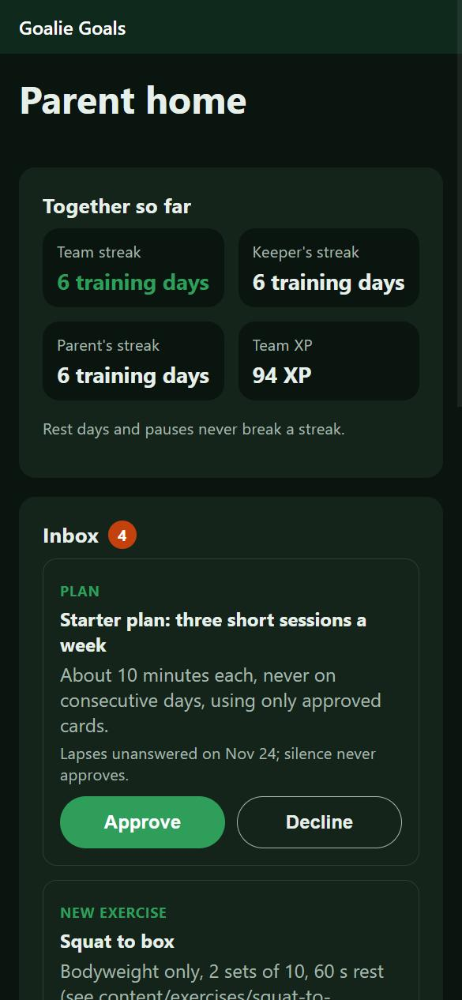
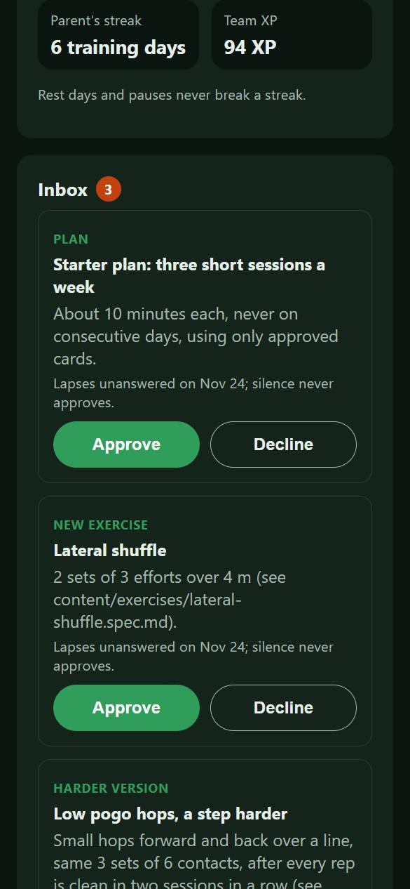
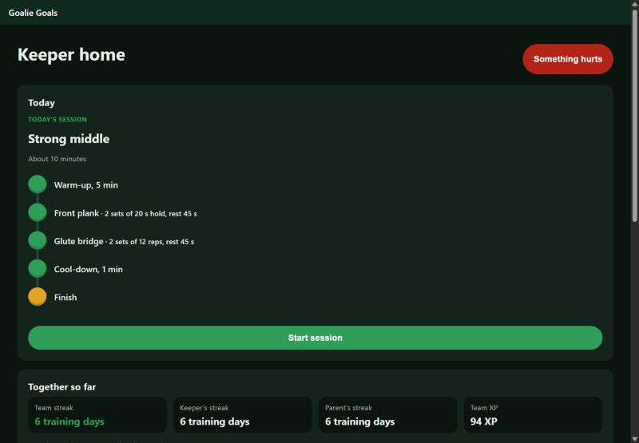
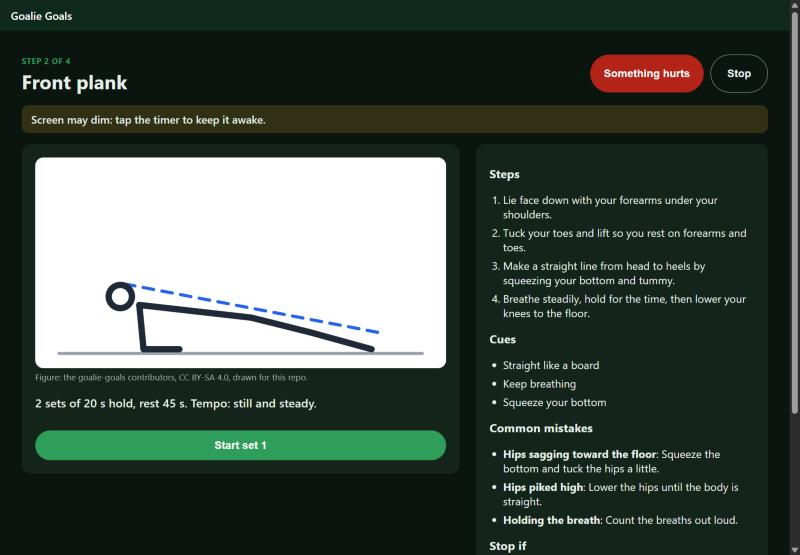
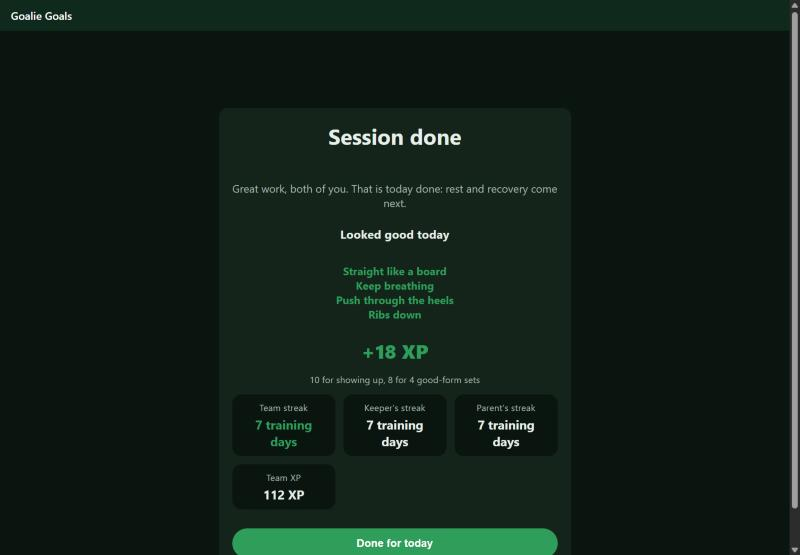
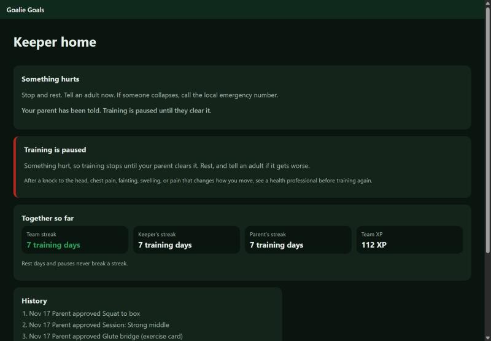
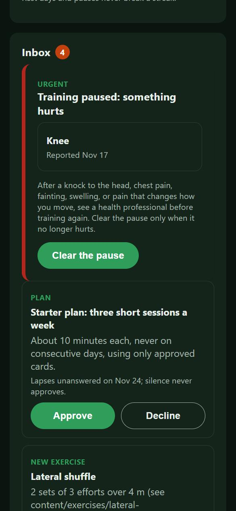
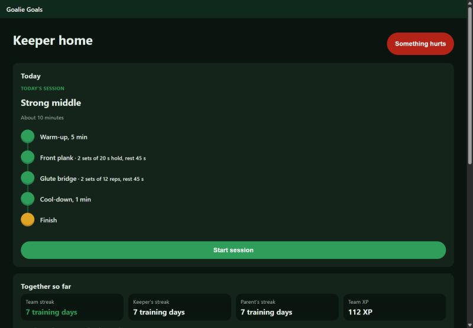

# The five-minute demo

A scripted walk through the core loop with the demo household: the parent approves on a
phone, the keeper plays today's session on an iPad, XP and streaks move, the keeper taps
**Something hurts** and training pauses, and the parent clears the pause.

The demo runs on your own machine, with the mock identity and the invented cast only:

| Who | Role | Account |
| --- | --- | --- |
| Kai | keeper | `kai@example.com` |
| Sam | parent | `sam@example.com` |

No real person's data is in it, and no deployed service is involved.

## Before the audience arrives

1. Start the demo server. It builds the web app, then serves it and the API on port 8080
   with the demo household seeded:

   ```bash
   npm install
   npm run demo
   ```

   `npm run demo` turns on the mock identity (`GOALIE_DEV_MOCK_IDENTITY=1`) and the demo seed
   (`GOALIE_DEMO_SEED=1`). Both are refused with `NODE_ENV=production`, and the seed refuses
   to run if the role seed (`GOALIE_ROLES`) names any account outside `@example.com`.
2. Open two browser windows, so each role keeps its own sign-in cookie:
   - **Window A (Sam, the parent):** a normal window, sized like a phone (in the browser's
     device toolbar, about 390 x 844).
   - **Window B (Kai, the keeper):** a private window, sized like an iPad in landscape (about
     1180 x 820).
3. Sign each window in with the dev-mock switch:
   - Window A: open `http://localhost:8080/api/dev/as?account=sam@example.com`, then
     `http://localhost:8080/`. It shows **Parent home**.
   - Window B: open `http://localhost:8080/api/dev/as?account=kai@example.com`, then
     `http://localhost:8080/`. It shows **Keeper home**.

What the seed gives you: today's starter session **Strong middle** (Front plank and Glute
bridge at their card doses) approved; four requests waiting in Sam's inbox; and a week of
history with five trained days, one planned rest day and one safety stop (Stop pressed on a
warning sign, which counts as a kept day). **Together so far** starts at a team streak of 6
training days and 94 XP.

To start again at any time, run `npm run demo:reset` in a second terminal and reload both
windows. It restores the seeded state as of today, and refuses if the data holds any account
outside `@example.com`.

## The script

### 1. The parent approves on the phone (about 1 minute)

In **Window A (Sam, phone)**:

1. Point at **Together so far**: team streak 6 training days, Kai's and Sam's streaks 6 each,
   94 XP. "Rest days and pauses never break a streak."
2. Scroll to **Inbox**, with its badge of **4**. Each request shows what would change and
   when it lapses: "silence never approves".
3. On **Squat to box** ("Bodyweight only, 2 sets of 10, 60 s rest"), tap **Approve**.
4. The badge drops to **3**, and **History** shows "Parent approved Squat to box".





### 2. The keeper plays today's session on the iPad (about 2 minutes)

In **Window B (Kai, iPad)**:

1. **Keeper home** shows **Today**: the path of steps for **Strong middle** (warm-up, Front
   plank, Glute bridge, cool-down, finish).
2. Tap **Start session**.
3. Warm-up: each move runs on a countdown. To keep the demo short, tap **Next** six times.
4. **Front plank** (2 sets of a 20 s hold): the figure and its credit line sit beside the
   steps, cues, common mistakes and stop signs.
   1. Tap **Start set 1**, then **End set** (or let the 20 s run).
   2. Under "How did set 1 look?", tap the cue **Straight like a board**. The app says
      "Straight like a board: nice": the cue, never the person.
   3. Tap **Skip rest**, then **End set**, then tap **Keep breathing**.
5. **Glute bridge** (2 sets of 12):
   1. Tap **Start set 1**, then **Set done** (or tap **+1** twelve times).
   2. Tap **Push through the heels**, then **Skip rest**, **Set done** and **Ribs down**.
6. Cool-down: tap **Next**.





### 3. XP and streaks (about 30 seconds)

Still in **Window B**:

1. The finish screen says **Session done**, lists what looked good today, and shows the XP
   earned: a fixed session credit for the logged warm-up plus one star for each of the 4 sets
   rated well (18 XP). There is no "one more?" prompt.
2. Tap **Done for today**. **Together so far** now shows a team streak of 7 training days and
   112 XP. Reps and minutes earn nothing: XP counts showing up and good form.



### 4. The keeper taps "Something hurts" (about 30 seconds)

Still in **Window B**:

1. Tap **Something hurts** in the top bar of **Keeper home**. (It is on every player screen
   too, and ends a session at once.)
2. Under "Where does it hurt?", choose **Knee**. Leave the note empty.
3. Tap **Tell my parent**. The home now shows **Training is paused** and offers nothing to
   train. The pause holds on the device even with the network off.



### 5. The parent clears the pause (about 1 minute)

In **Window A (Sam, phone)**:

1. Reload. The **Inbox** starts with an **Urgent** item, **Training paused: something
   hurts**, with the body area **Knee**.
2. Tap **Clear the pause**. Only a parent can: a keeper's attempt is refused and logged.
   **History** shows the pause and the clear, with roles and the body area only.
3. In **Window B (Kai, iPad)**, reload. The pause is lifted, and **Together so far** still
   shows the streak: a pause never breaks one.





## After the demo

Run `npm run demo:reset` and reload both windows to put the household back as it started.
Stop the server with Ctrl+C; nothing is kept, since the demo stores live in memory.

## Taking the screenshots

- Take them from this local run with the demo household only, at the window sizes above.
- Crop to the app's own page: no browser address bar, tabs or bookmarks.
- Save as PNG or WebP with the metadata stripped, under `docs/demo/`, with the file names
  in the placeholders. Camera formats are refused by the privacy guard.
